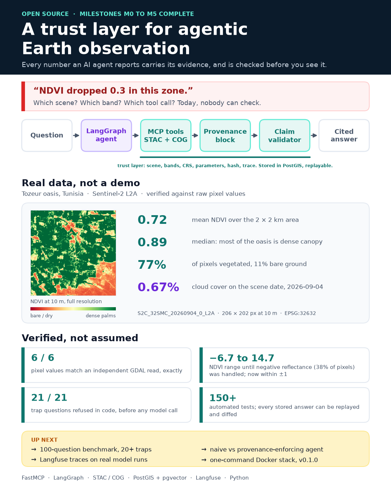
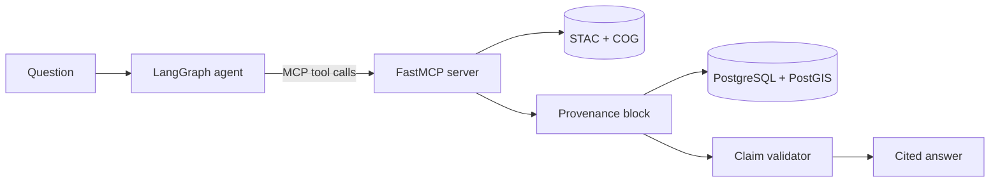

# geo-evidence-mcp

**A trust layer for agentic Earth observation.** An MCP server and a LangGraph agent that answer
questions about Sentinel-2 imagery, where every number carries machine-checkable provenance and is
verified before it reaches the user.



## The problem

An EO agent says *"NDVI dropped 0.3 in this zone."* Which scene? Which band? Which tool call? What
cloud mask? Today nobody can check. GIS MCP servers already exist (CARTO, Esri and others); what is
missing is evidence that the answers are correct.

## How it works



- **MCP tools** (`search_stac`, `load_window`, `band_math`, `zonal_stats`, `get_provenance`, `health`)
  read Sentinel-2 L2A COGs directly. Every numeric result carries a **provenance block**: scene, bands,
  CRS, grid, scale/offset, cloud-mask and clipping parameters, an `args_hash` and a trace. Blocks are
  stored in PostgreSQL/PostGIS and **replayable**: `get_provenance(id, replay=true)` re-runs the call and
  diffs every number.
- **The agent** only plans and narrates. Scene choice, analysis and evidence checks are code. A
  **claim validator** requires every number in an answer to equal a recorded tool output (or a
  difference of two); a rejected draft is rewritten, and after three failures the answer is built by
  code from the outputs, so an unsupported number never reaches the user.
- **Refusals are deterministic**: finer than 10 m resolution, forecasts, quantities optical imagery
  cannot give, object counting, oversized or future requests are refused in code before any model call.
  Tiny areas and heavy cloud lower confidence explicitly.
- **Cloud masking** uses the Scene Classification Layer, recorded in the provenance.

## Verification status

| Claim | Status |
|---|---|
| Data layer matches raw Sentinel-2 pixel values (Tozeur oasis, scene `S2C_32SMC_20260904_0_L2A`) | Verified: 6/6 values equal an independent GDAL read. Evidence: [`docs/evidence/`](docs/evidence/) |
| MCP tools work against the live Earth Search catalog | Verified by the opt-in integration tests |
| 150+ automated tests, `mypy --strict`, ruff | Passing |
| PostGIS storage and replay | Tested against PostgreSQL 16 + PostGIS 3.4; Docker image build in CI pending |
| SCL cloud masking | Verified on synthetic scenes (pixel-exact alignment); live check pending |
| Agent with a real model (Claude) | Pending. The agent is tested end to end with a scripted model |
| Langfuse traces | Adapter tested with a local OpenTelemetry exporter; server run pending |

Nothing in the table is claimed beyond its status. Benchmark results: **PENDING** (no real run exists yet).

## What broke on real data (and what it taught)

- **NDVI from -6.7 to +14.7.** Since processing baseline 04.00, L2A digital numbers carry a +1000 offset,
  so dark pixels become slightly negative reflectance (38% of the oasis pixels) and near-zero denominators
  blow up the ratio. Reflectance is now clipped at 0 and the rule is recorded in every block.
- **A global `PROJ_LIB` from a PostgreSQL install** overrode the PROJ data bundled with rasterio and broke
  every CRS lookup. The package now prefers the bundled data, with a regression test.
- **pgvector's default `-march=native`** can produce an image that crashes on another CPU; the Dockerfile
  builds with `OPTFLAGS=""`.

## Quickstart

Python 3.12+ and [uv](https://docs.astral.sh/uv/).

```bash
uv sync
uv run pytest                                   # offline suite
uv run gem-m1-check --start 2026-08-01 --end 2026-11-10   # live Tozeur NDVI check (internet)
uv run gem-mcp                                  # MCP server on stdio
ANTHROPIC_API_KEY=... uv run gem-ask "What was the mean NDVI of the Tozeur oasis in September 2026?"
```

`make init` creates a `.env` with generated secrets; `docker compose up -d --build --wait db` starts
PostGIS + pgvector. See [`docs/adr/`](docs/adr/) for the design decisions and their limits.

## Roadmap

| Milestone | Scope | State |
|---|---|---|
| M0 | Scaffold, compose, CI, ADR-001 | done (CI Docker job pending) |
| M1 | Data layer, hand-verified on a real scene | done |
| M2 | FastMCP server | done |
| M3 | Provenance, PostGIS store, replay, claim validator | done |
| M4 | LangGraph agent, tracing adapters | done (scripted-model tests) |
| M5 | Deterministic refusals, low-confidence flags, SCL cloud masking | done |
| M6 | 100-question benchmark with ground truth, 20+ hallucination traps, eval runner | next |
| M7 | Naive agent vs provenance-enforcing agent, results table | planned |
| M8 | One-command Docker stack, demo, v0.1.0 | planned |

## Limits

The validator proves that a number came from a tool, not that the sentence around it is true. Places
come from a small gazetteer or user-supplied coordinates (no geocoder yet). SCL is itself a model output.
See ADR-004, ADR-005 and ADR-006.

MIT licensed.
